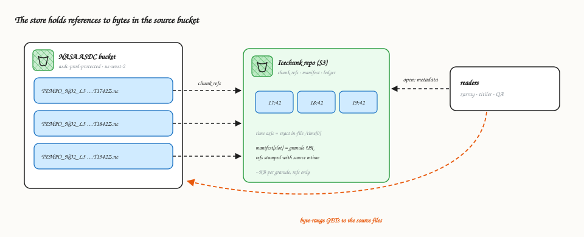
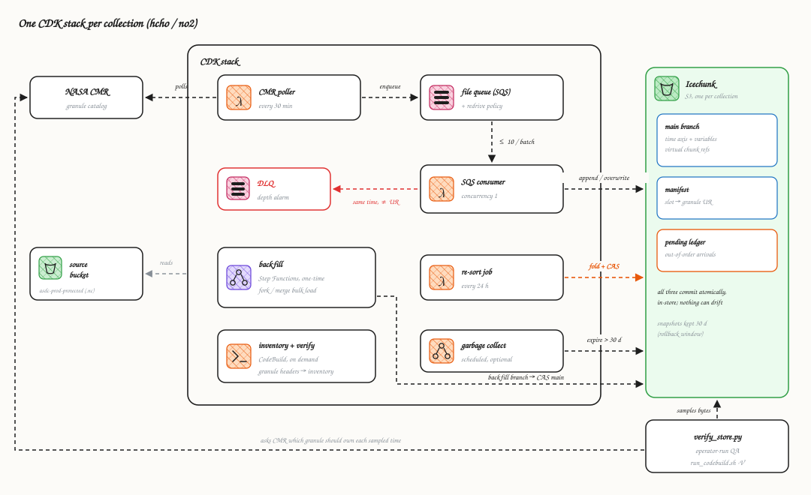
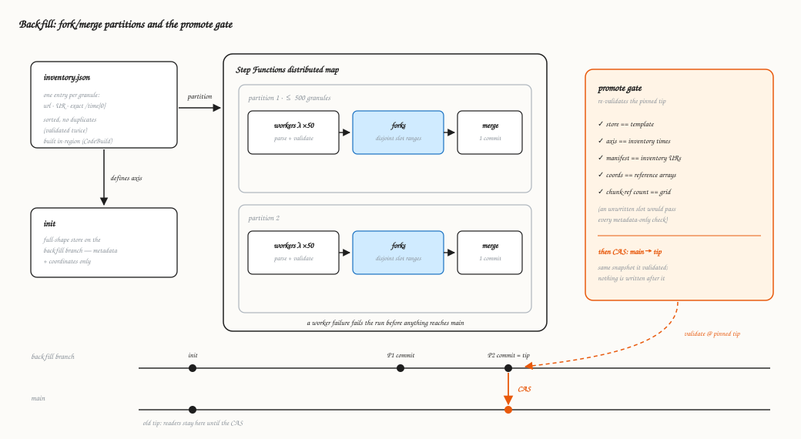
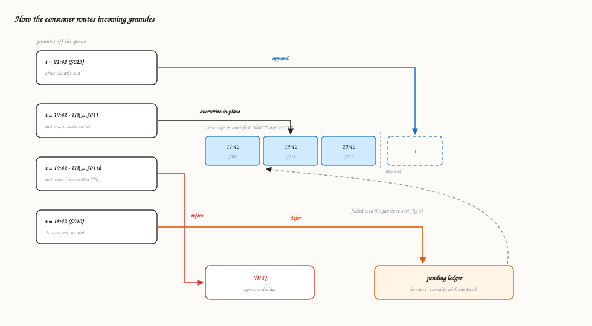
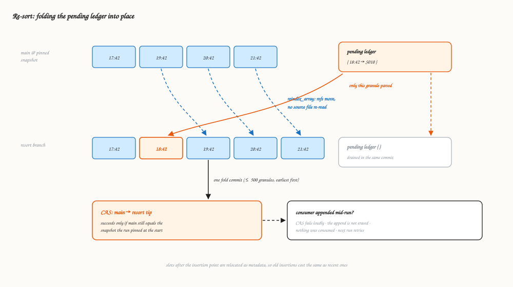
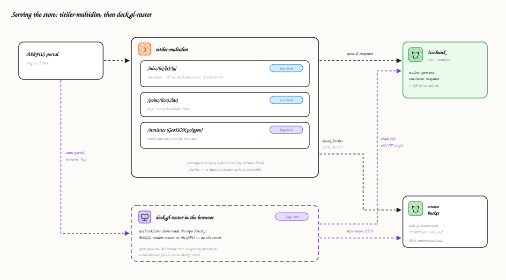

# Architecture

These figures show how TEMPO Level 3 granules (NO₂ and HCHO) are ingested
into one virtual Zarr store per collection, and how the pipeline guards
against serving wrong data.

In the figures, **blue** marks data (granules, time slots), **orange** marks
the correctness mechanism under discussion, and dashed lines are
asynchronous paths. This page is the conceptual map. The operating pages
([deploying](deploying.md), [settings](settings.md), the runbooks) cover the
day-to-day work, and [The pipeline](pipeline.md) covers each stage in detail.

## Why this design

Three properties of the TEMPO source drive everything unusual here. If your
dataset lacks a property, you do not need the machinery in that row.

| Source property | Forces | Delete it when |
|---|---|---|
| ASDC publishes no SNS topic for the source bucket | CMR poller + watermark | ASDC provides a notification topic (the queue subscribes directly) |
| The in-file `/time` differs from the CMR and filename timestamps (`...T174200Z` holds 17:42:18.02), so a granule's slot on the axis is unknowable without reading the file | The ownership manifest. The pending ledger + re-sort job, because a slot cannot be pre-created for a granule nobody has read | the metadata times become exact |
| The DAAC revises and republishes granules **to the same S3 URI** | UR-checked routing (overwrite the same UR in place, reject a different UR to an operator). Modification-time-stamped references, so stale reads fail loudly | never, for this DAAC |

Everything else is the standard machinery of the
[template](https://github.com/developmentseed/virtualizarr-data-pipelines)
family, not TEMPO-specific. That includes the fork/merge backfill, the
compare-and-swap promotes, and the pinned-tip validation.

## 1. Virtual stores

The store does not copy NASA's data. It is a Zarr-shaped index over the
original NetCDF granules: per-chunk byte-range references, a time axis built
from each granule's in-file scan time, and bookkeeping that records which
granule owns which slot. Readers open a few KB of metadata and then fetch
bytes directly from the source bucket.

Each reference records the source object's modification time. If a granule
is overwritten in place upstream, reads of the stale references fail instead
of returning bytes from a changed file.

## 2. Stack components

Each collection is deployed as its own CDK stack, configured through typed
settings (pydantic `BaseSettings`). A scheduled Lambda polls CMR for new
revisions. An SQS queue feeds a consumer Lambda with reserved concurrency 1.
Scheduled jobs handle re-sort, garbage collection, and the backfill state
machine. An on-demand CodeBuild project runs the in-region jobs: backfill
inventory builds, stamp recording, and store verification. The manifest and
pending ledger are stored inside the Icechunk repo and commit atomically
with the data they describe.

`verify_store.py` runs outside the pipeline's write path. It is started
in-region through the same CodeBuild project with `run_codebuild.sh -V`,
because source reads are region-locked to us-west-2. It asks CMR which
granule should own each sampled time and compares stored bytes against the
source file. Errors in the pipeline's own bookkeeping are therefore still
caught.

## 3. Backfill

The historical archive is loaded with a partitioned fork/merge. The
inventory is built by the stack's CodeBuild project, because the DAAC's
temporary source-bucket credentials only work from us-west-2. Each run
executes the committed builder script from a source zip of the repo. The
validated inventory defines the full time axis up front. Workers write
disjoint slot ranges into Icechunk forks, and each partition is merged into
a single commit on the `backfill` branch. The promote step re-validates the
finished store at a pinned snapshot and then moves `main` with a
compare-and-swap, so `main` never points at a partial store.

The chunk-reference count check exists because an unwritten slot reads as
fill values and passes the metadata checks. Counting stored references
against the chunk grid confirms that every slot was written.

## 4. Forward processing

Publication order routinely diverges from scan-time order. In a 14-day
window measured in August 2026, about 43% of adjacent publications were out
of order. See [Forward processing](pipeline.md#forward-processing) for the
breakdown. The consumer therefore cannot assume arrival order matches time
order. Each granule is routed against the axis and the ownership manifest.
Granules that cannot be placed safely are deferred to the pending ledger or
sent to the DLQ for an operator.

Append and same-owner overwrite are the only automatic writes. A time
collision with a different granule UR is left to an operator.

## 5. Re-sort

A scheduled job folds the pending ledger into the store. Icechunk's
`reindex_array` relocates the slots after the insertion point as metadata,
without re-reading any source file. Only the inserted granules are parsed.
The fold and the ledger drain happen in one commit, and `main` moves by
compare-and-swap.

If the consumer appended to `main` while the re-sort ran, the CAS fails. The
append survives, no ledger entry was consumed, and the next run retries
against the new tip. Each run folds at most `RESORT_MAX_FOLD` granules.

## 6. Serving

The portal reads the store through titiler-multidim. It renders map tiles
through `/tiles`, where each render selects one scan with `sel=time` and
nearest matching, because a multi-time variable cannot reach the renderer.
It reads pixel time series through `/point`. Both passed the smoke test
against real stores. Longer term, `/statistics` computes zonal statistics
for a GeoJSON polygon across the time axis. In every case titiler opens the
repo at a snapshot and fetches the referenced bytes from the source bucket
with EDL-authorized virtual chunk fetches. Per-request latency is dominated
by those fetches, so a dataset/session cache is advisable in production.

deck.gl-raster is the long-term alternative that removes the tile server.
An icechunk/zarr client in the browser reads the repo's metadata and
references directly, and WebGL renders the rasters on the GPU. Both paths
read the same snapshots. Nothing is duplicated for serving. Since references
became relative, a client anywhere can read chunks over the DAAC's HTTPS
distribution with an EDL bearer token, as
[the HTTPS quickstart](../examples/quickstart-https.ipynb) does. The open
question for the browser path is how to deliver that token safely.

## Glossary

- **Granule**: one NetCDF file. A single TEMPO scan of North America,
  published roughly hourly during daylight.
- **Granule UR**: the granule's unique identifier in CMR. The manifest's
  notion of ownership. A slot belongs to exactly one UR.
- **Collection**: one TEMPO product (NO₂ or HCHO L3 V04). Each collection
  gets its own stack and its own store.
- **CMR**: NASA's Common Metadata Repository, the catalog of record for
  granules. The poller watches its revision dates. Verification uses it as
  ground truth independent of the pipeline's own bookkeeping.
- **Virtual reference**: a pointer (source URL, byte offset, length, and the
  source object's modification time) standing in for a chunk's bytes. The
  store consists of these references.
- **Icechunk snapshot / branch**: git-like versioning for the store. Every
  commit is an immutable snapshot. Branches (`main`, `backfill`, `resort`)
  are movable pointers to snapshots. Readers always see a complete,
  consistent snapshot.
- **CAS (compare-and-swap)**: a branch move that succeeds only if the branch
  still points at the snapshot the mover expected. It is the only way
  anything reaches `main`. A promote that races a concurrent commit fails
  instead of overwriting it.
- **Pinned tip**: the snapshot a run looks up once at its start. Validation
  and promotion target that same object, so a branch moving mid-run cannot
  substitute an unvalidated snapshot.
- **Fork / merge**: Icechunk's cooperative distributed write. Workers write
  disjoint regions on uncommitted forks of a session, which merge into a
  single commit.
- **Slot**: one position on the store's time axis, keyed to a granule's
  exact in-file `/time[0]`, which differs from the filename timestamp.
- **Store manifest**: two string arrays on the time axis recording each
  slot's owning granule UR and URL. It lives inside the store and commits
  atomically with the data it describes.
- **Pending ledger**: the in-store record of granules that arrived out of
  time order. They were consumed from the queue but not yet placed. The
  re-sort job drains it.
- **`reindex_array`**: the Icechunk operation that relocates chunk
  references to new indices as pure metadata. It makes insertion into the
  middle of the axis cheap. Downstream slots are re-addressed, not re-read.
- **Promote gate**: the backfill's final validation pass at the pinned tip
  (template, axis, manifest, coordinates, chunk-reference counts). It must
  pass before the CAS moves `main`.
- **Store template**: a pydantic-zarr `GroupSpec` generated from reference
  granules, declaring the store's exact expected structure. Every granule is
  validated against it before writing.
- **Watermark**: the persisted CMR revision timestamp the poller resumes
  from, so restarts neither miss nor re-enqueue granules. The only pipeline
  state living outside the store.
- **DLQ / redrive policy**: the dead-letter queue receives messages two
  ways. The consumer *rejects* a granule whose time slot is owned by a
  different UR, and SQS's redrive policy moves any message that has failed
  processing 20 times. Either way, a depth alarm notifies an operator.
- **EDL**: Earthdata Login. NASA credentials exchanged for temporary S3
  access, or used as a bearer token, to read the protected source granules.
